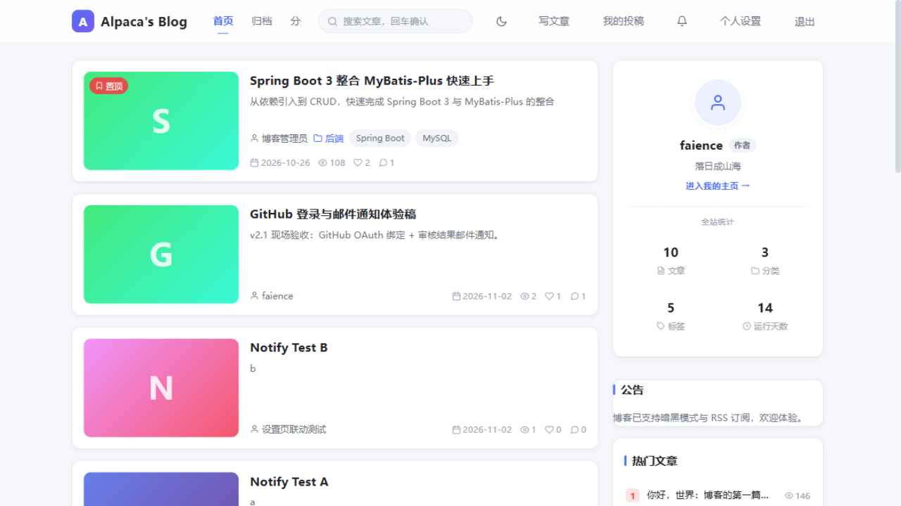
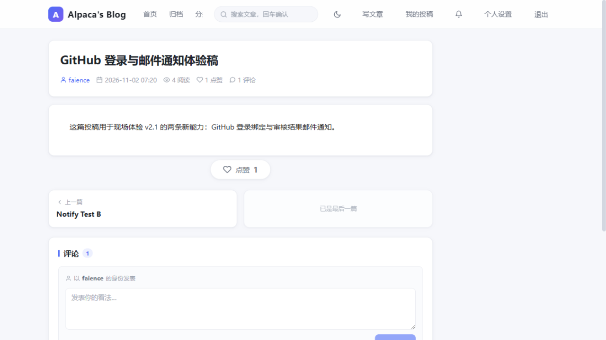
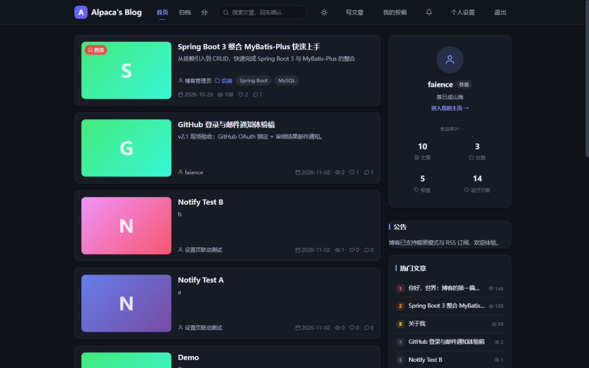
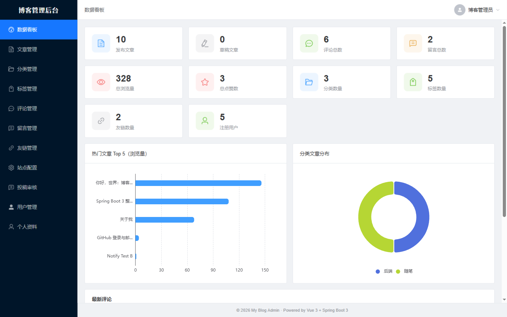

# 个人博客系统（blog）

前后端分离的个人博客：**Spring Boot 3 + MyBatis-Plus + MySQL 8 + Redis + Sa-Token** 后端，**Vue 3 + Vite + TypeScript** 前台门户（`blog-front`）与后台管理（`blog-admin`）。

设计与实现依据：[docs/设计文档.md](docs/设计文档.md)。

## 项目截图

**前台门户 · 首页**（文章卡片流 + 站点统计/热门文章侧栏）



**前台门户 · 文章详情**（Markdown 渲染 + 代码高亮 + 自动目录 + 两级评论区）



**前台门户 · 暗黑模式**（一键切换、跟随系统偏好、Markdown 暗色渲染）



**后台管理 · 数据看板**（统计卡片 + 浏览量 Top5 / 分类分布图表 + 最新评论）



## 目录结构

```
blog/
├── docs/                   # 设计文档（架构/数据库/API/部署/迭代清单）+ 各迭代评审文档
│   └── 设计文档.md
├── sql/
│   ├── schema.sql          # 建库建表（11 张表）
│   └── data.sql            # 种子数据（管理员/分类/标签/示例文章/友链/评论）
├── blog-server/            # 后端 Spring Boot 3（端口 8080）
├── blog-front/             # 前台门户（dev 端口 5173）
├── blog-admin/             # 后台管理（dev 端口 5174）
└── deploy/                 # 生产部署
    ├── Dockerfile          # 后端镜像（temurin 17 + jar）
    ├── docker-compose.yml  # 编排（mysql/redis/server/nginx）
    ├── nginx.conf          # Nginx（静态 + API 反代 + 图片直出）
    ├── .env.example        # 部署环境变量样例（密码/SMTP/GitHub OAuth）
    └── backup/             # MySQL 备份脚本 + 恢复说明
```

## 功能一览

**基础（v1.0 标准版）**

- **前台**：文章列表/详情（Markdown 渲染 + 代码高亮 + 目录）、点赞、评论（两级）、搜索、归档、分类、标签、留言板、友链、关于、站点统计
- **后台**：登录（Sa-Token + BCrypt）、数据看板、文章管理（md-editor-v3 编辑器、图片上传、草稿/发布/下架、置顶）、分类/标签/评论/留言/友链管理
- **机制**：浏览量 Redis 缓冲 + 定时落库、点赞防重（唯一键 + 开关语义）、评论/留言 IP 限频、上传文件头校验、逻辑删除

**迭代交付（v1.1 ~ v2.2）**

- **体验增强**：数据看板图表化（ECharts）、暗黑模式、RSS 订阅、SEO（meta/sitemap/robots）、站点可视化配置、MySQL FULLTEXT 中文全文检索、OSS/MinIO 图床
- **多用户社区**：注册/登录（BCrypt + 限频）、投稿审核制（通过/退回附原因）、个人主页、用户管理（封禁即踢/重置密码）、个人设置（头像上传/资料/换绑邮箱/改密）
- **账号与消息**：邮箱验证码注册、找回密码、换绑邮箱、GitHub OAuth 登录/绑定、审核结果邮件通知（用户级开关）、站内通知中心（页头铃铛未读 + 通知页）
- **创作与运维保障**：编辑器草稿本地自动保存/恢复、MySQL 定时备份脚本（保留 30 份）与恢复方案
- **部署**：Docker Compose 一键编排（MySQL 自动初始化/Redis/后端/Nginx），SMTP 与 GitHub OAuth 全环境变量配置

## 环境要求

| 组件 | 版本 |
| --- | --- |
| JDK | 17+ |
| Maven | 3.8+ |
| Node.js | 18+ |
| MySQL | 8.x |
| Redis | 6.x / 7.x（生产由 Docker 提供；Windows 开发可用 `docker run -d -p 6379:6379 redis:7-alpine` 或 Memurai） |

## 快速开始（开发环境）

### 1. 初始化数据库

方式 A —— 本机 MySQL（当前 MySQL80 服务已在运行）：

```bash
mysql -u root -p < sql/schema.sql
mysql -u root -p < sql/data.sql
```

方式 B —— Docker 起一个仅开发用的 MySQL（首次启动自动执行 sql/ 下脚本）：

```bash
docker run -d --name blog-mysql-dev -p 3306:3306 ^
  -e MYSQL_ROOT_PASSWORD=root123 ^
  -e MYSQL_DATABASE=blog ^
  -v "%cd%/sql":/docker-entrypoint-initdb.d ^
  mysql:8.0
```

> `data.sql` 只能执行一次（重复执行会插入重复数据）。默认管理员：`admin / admin123`。

### 2. 配置后端连接

编辑 `blog-server/src/main/resources/application-dev.yml`，把 MySQL 密码改成你的（方式 B 填 `root123`），Redis 保持 `localhost:6379`。

### 3. 启动三个服务

```bash
# 后端（blog-server 目录）
mvn spring-boot:run

# 前台（blog-front 目录）
npm install
npm run dev        # http://localhost:5173

# 后台（blog-admin 目录）
npm install
npm run dev        # http://localhost:5174
```

开发环境跨域已由 Vite proxy 解决（`/api`、`/upload` → 8080），后端无需额外配置。

### 4. 登录后台

访问 `http://localhost:5174`，账号 `admin` / 密码 `admin123`（**上线前务必在「个人资料」中修改密码**）。

## 生产部署（Docker Compose）

编排文件位于 [`deploy/`](deploy/)：MySQL 8（首次启动自动按序执行 `sql/schema.sql` + `sql/data.sql`）、Redis 7、后端 jar、Nginx（前台 + 后台静态资源 + API 反代 + 图片直出）。

```bash
# 1. 构建产物：后端 jar + 两个前端 dist（Nginx 直接挂载）
cd blog-server && mvn -DskipTests package && cd ..
cd blog-front && npm install && npm run build && cd ..
cd blog-admin && npm install && npm run build && cd ..

# 2. 配置部署环境变量（MySQL 密码 / 站点地址 / SMTP 邮件）
cd deploy && cp .env.example .env   # 修改密码与邮箱配置后保存

# 3. 一键拉起（在 deploy/ 目录执行）
docker compose up -d --build
```

- 前台：`http://localhost/`；后台：`http://localhost/admin`；图片：`/upload`（Nginx 直出）
- 邮件服务：`deploy/.env` 里配置 `MAIL_TYPE=smtp` 与 QQ/163 授权码即发真实邮件；不配置自动退化为日志模拟
- GitHub 登录：`deploy/.env` 配置 `GITHUB_CLIENT_ID/SECRET`（OAuth App callback 填 `http://localhost/auth/github`）；不配置时点击该入口会提示未配置
- 数据备份/恢复：见 [deploy/backup/README.md](deploy/backup/README.md)（计划任务 + 恢复命令）
- 图床切换 MinIO/OSS：给 `server` 服务加 `blog.storage.type=oss` 及 OSS 连接参数即可（见设计文档 §7）
- 数据与上传文件持久化在命名卷 `mysql-data` / `upload` 中
- 上线后第一件事：登录 `/admin` 修改默认密码
- 说明：`deploy/.env` 含密码/授权码，已加入 `.gitignore` 不会入库

## 常见问题

| 现象 | 原因与处理 |
| --- | --- |
| 后端启动报 `Access denied for user 'root'` | `application-dev.yml` 密码与实际不符 |
| 后端启动报 Redis `Connection refused` | 本机 6379 未监听，先启动 Redis（见环境要求） |
| 后台登录报 401 | 未执行 `data.sql`（没有 admin 账号）或 token 过期 |
| 评论报「操作太频繁」 | IP 限频：每分钟 5 条，属预期行为 |
| 文章详情浏览量不同步 | 浏览量先进 Redis，每 10 分钟定时落库一次 |

## 迭代状态

| 阶段 | 状态 |
| --- | --- |
| M1~M4 标准版（工程骨架 / 文章闭环 / 互动与完整页面 / 部署） | ✅ |
| v1.1 看板图表化（ECharts）+ Element Plus 按需引入 | ✅ |
| v1.2 OSS/MinIO 图床 + 暗黑模式 + RSS 订阅 | ✅ |
| v1.3 SEO 优化（meta / sitemap / robots） | ✅ |
| v1.4 站点配置表（后台可视化配置 → 前台联动） | ✅ |
| v1.5 MySQL FULLTEXT 中文全文检索 | ✅ |
| v1.6 多用户社区化（注册/投稿审核/个人主页/用户管理） | ✅ |
| 个人设置页（头像上传/资料/换绑邮箱/修改密码） | ✅ |
| 打包 + Docker Compose 部署编排（含本地图床 404 修复） | ✅ |
| v2.0 邮件服务（注册邮箱验证/找回密码/换绑邮箱） | ✅ |
| v2.1 消息通知与 GitHub 登录（审核邮件通知/通知开关/OAuth） | ✅ |
| v2.2 站内通知中心 + 草稿自动保存 + MySQL 定时备份 | ✅ |
| v2.3 站内通知扩展（通知类型扩展/中心增强/未读轮询） | 📝 评审中 |

> 各阶段设计与决策详见 [docs/设计文档.md](docs/设计文档.md) 附录 B 及对应评审文档。
