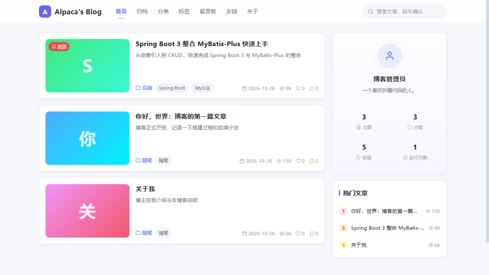
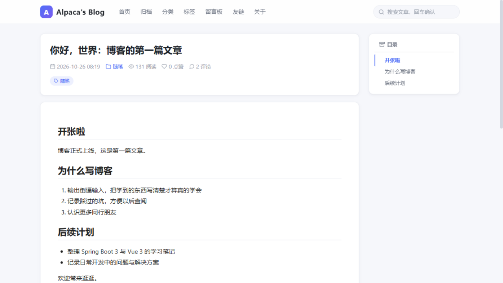
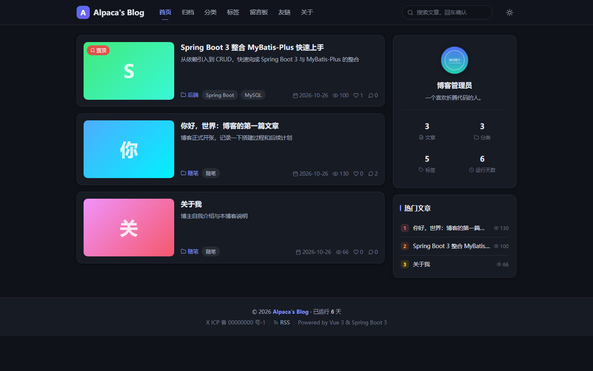
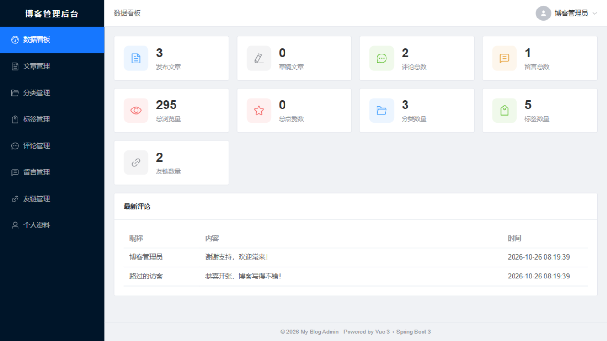

# 个人博客系统（blog）

前后端分离的个人博客：**Spring Boot 3 + MyBatis-Plus + MySQL 8 + Redis + Sa-Token** 后端，**Vue 3 + Vite + TypeScript** 前台门户（`blog-front`）与后台管理（`blog-admin`）。

设计与实现依据：[docs/设计文档.md](docs/设计文档.md)。

## 项目截图

**前台门户 · 首页**（文章卡片流 + 站点统计/热门文章侧栏）



**前台门户 · 文章详情**（Markdown 渲染 + 代码高亮 + 自动目录 + 两级评论区）



**前台门户 · 暗黑模式**（一键切换、跟随系统偏好、Markdown 暗色渲染）



**后台管理 · 数据看板**（统计卡片 + 浏览量 Top5 / 分类分布图表 + 最新评论）



## 目录结构

```
blog/
├── docs/设计文档.md        # 设计文档（架构 / 数据库 / API / 部署 / 里程碑）
├── sql/
│   ├── schema.sql          # 建库建表（9 张表）
│   └── data.sql            # 种子数据（管理员/分类/标签/示例文章/友链/评论）
├── blog-server/            # 后端 Spring Boot 3（端口 8080）
├── blog-front/             # 前台门户（dev 端口 5173）
├── blog-admin/             # 后台管理（dev 端口 5174）
├── deploy/nginx.conf       # 生产 Nginx 配置
└── docker-compose.yml      # 生产编排（mysql/redis/server/nginx）
```

## 功能一览（标准版）

- **前台**：文章列表/详情（Markdown 渲染 + 代码高亮 + 目录）、点赞、评论（两级）、搜索、归档、分类、标签、留言板、友链、关于、站点统计
- **后台**：登录（Sa-Token + BCrypt）、数据看板、文章管理（md-editor-v3 编辑器、图片上传、草稿/发布/下架、置顶）、分类/标签/评论/留言/友链管理、个人资料与改密
- **特色机制**：浏览量 Redis 缓冲 + 定时落库、点赞防重（唯一键 + 开关语义）、评论/留言 IP 限频、上传文件头校验、逻辑删除

## 环境要求

| 组件 | 版本 |
| --- | --- |
| JDK | 17+ |
| Maven | 3.8+ |
| Node.js | 18+ |
| MySQL | 8.x |
| Redis | 6.x / 7.x（生产由 Docker 提供；Windows 开发可用 `docker run -d -p 6379:6379 redis:7-alpine` 或 Memurai） |

## 快速开始（开发环境）

### 1. 初始化数据库

方式 A —— 本机 MySQL（当前 MySQL80 服务已在运行）：

```bash
mysql -u root -p < sql/schema.sql
mysql -u root -p < sql/data.sql
```

方式 B —— Docker 起一个仅开发用的 MySQL（首次启动自动执行 sql/ 下脚本）：

```bash
docker run -d --name blog-mysql-dev -p 3306:3306 ^
  -e MYSQL_ROOT_PASSWORD=root123 ^
  -e MYSQL_DATABASE=blog ^
  -v "%cd%/sql":/docker-entrypoint-initdb.d ^
  mysql:8.0
```

> `data.sql` 只能执行一次（重复执行会插入重复数据）。默认管理员：`admin / admin123`。

### 2. 配置后端连接

编辑 `blog-server/src/main/resources/application-dev.yml`，把 MySQL 密码改成你的（方式 B 填 `root123`），Redis 保持 `localhost:6379`。

### 3. 启动三个服务

```bash
# 后端（blog-server 目录）
mvn spring-boot:run

# 前台（blog-front 目录）
npm install
npm run dev        # http://localhost:5173

# 后台（blog-admin 目录）
npm install
npm run dev        # http://localhost:5174
```

开发环境跨域已由 Vite proxy 解决（`/api`、`/upload` → 8080），后端无需额外配置。

### 4. 登录后台

访问 `http://localhost:5174`，账号 `admin` / 密码 `admin123`（**上线前务必在「个人资料」中修改密码**）。

## 生产部署（Docker Compose）

```bash
# 1. 构建两个前端产物（nginx 直接挂载 dist 目录）
cd blog-front && npm install && npm run build && cd ..
cd blog-admin && npm install && npm run build && cd ..

# 2. 一键拉起（MySQL 首次启动自动执行 sql/ 初始化）
docker compose up -d --build
```

- 前台：`http://localhost/`；后台：`http://localhost/admin`；图片：`/upload`
- MySQL 密码通过环境变量 `MYSQL_ROOT_PASSWORD` 覆盖默认值
- 数据与上传文件持久化在 `data/` 目录
- 上线后第一件事：登录 `/admin` 修改默认密码

## 常见问题

| 现象 | 原因与处理 |
| --- | --- |
| 后端启动报 `Access denied for user 'root'` | `application-dev.yml` 密码与实际不符 |
| 后端启动报 Redis `Connection refused` | 本机 6379 未监听，先启动 Redis（见环境要求） |
| 后台登录报 401 | 未执行 `data.sql`（没有 admin 账号）或 token 过期 |
| 评论报「操作太频繁」 | IP 限频：每分钟 5 条，属预期行为 |
| 文章详情浏览量不同步 | 浏览量先进 Redis，每 10 分钟定时落库一次 |

## 里程碑状态

| 里程碑 | 状态 |
| --- | --- |
| M1 工程骨架（三工程 + 统一响应/异常 + 登录鉴权） | ✅ |
| M2 文章管理闭环（编辑器/上传/前台渲染/浏览量落库） | ✅ |
| M3 互动与完整页面（评论/点赞/搜索/归档/友链/看板） | ✅ |
| M4 部署（Dockerfile / docker-compose / nginx） | ✅ |
| 进阶迭代（OSS 图床 / 暗黑模式 / RSS / SEO / 全文检索） | 待规划（见设计文档附录 B） |
