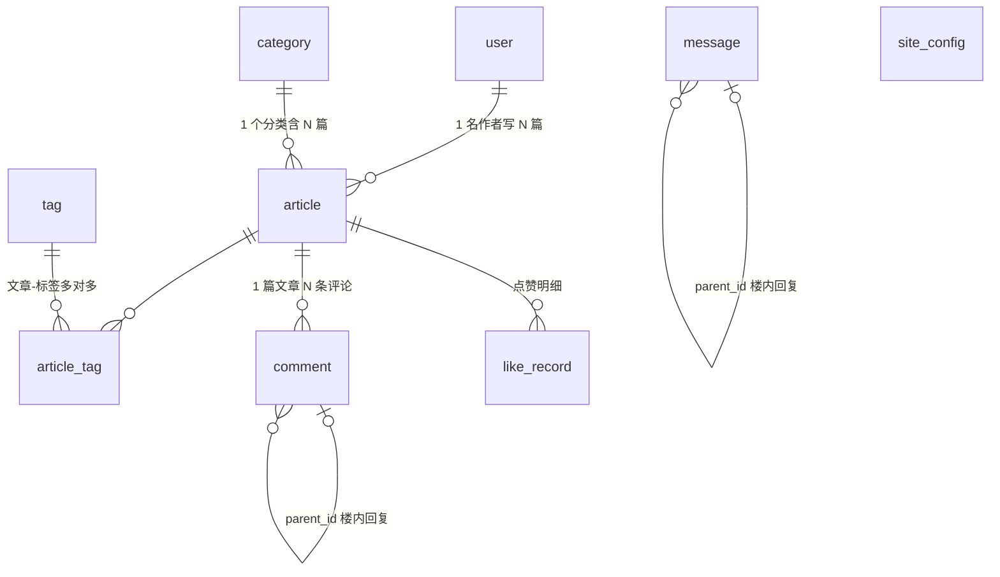

# 个人博客系统设计文档

| 项 | 内容 |
| --- | --- |
| 版本 | v1.1 |
| 日期 | 2026-10-31 |
| 状态 | 已实现（文档已与代码对齐，实现与原设计的差异以「实现时调整」标注，可全文搜索定位） |
| 技术栈 | Spring Boot 3 + Vue 3（前后端分离） |
| 功能范围 | 标准版 |

---

## 目录

1. [项目概述](#1-项目概述)
2. [总体架构](#2-总体架构)
3. [技术选型清单](#3-技术选型清单)
4. [功能需求清单](#4-功能需求清单)
5. [数据库设计](#5-数据库设计)
6. [API 接口设计](#6-api-接口设计)
7. [核心流程设计](#7-核心流程设计)
8. [项目目录结构](#8-项目目录结构)
9. [部署方案](#9-部署方案)
10. [开发里程碑](#10-开发里程碑)

---

## 1. 项目概述

### 1.1 项目定位

一个**个人博客**：仅有一名管理员（博主）负责写作与内容管理，访客免登录即可浏览、搜索、评论、点赞、留言。项目同时承担两个目的：

1. **实用目的**：搭建一个真正可上线使用的个人博客站点；
2. **学习目的**：完整实践前后端分离架构（Spring Boot 3 + Vue 3）的主流技术组合。

### 1.2 设计目标

- **结构清晰**：三个工程（前台、后台、服务端）职责单一，方便维护与扩展；
- **开发效率**：单表 CRUD 依托 MyBatis-Plus，避免手写模板 SQL；数据库与骨架代码可自动生成；
- **体验优先**：Markdown 写作与渲染、代码高亮、响应式布局；
- **可部署**：一条 `docker compose up` 即可拉起全套环境。

### 1.3 用户与角色

| 角色 | 说明 | 登录 |
| --- | --- | --- |
| 管理员 | 博主本人。写作文章、管理分类/标签/评论/留言/友链、审核投稿、管理用户、查看数据看板 | 需要（账号密码 → JWT token） |
| 注册用户（USER） | 社区作者：评论/留言（身份由账号派生）、投稿（审核制）、个人主页 | 需要（注册 → 登录） |
| 访客 | 任何人。浏览、搜索、点赞、订阅 RSS（评论与留言需登录，v1.6 决策） | 无需登录 |

> 多用户社区已于 v1.6 实现（[设计评审](多用户社区化设计评审.md)），注册用户投稿走审核制。

---

## 2. 总体架构

### 2.1 架构图

```
┌──────────────────────────────────────────────────────────────┐
│                           浏览器                              │
│    访客: blog-front (前台门户)       管理员: blog-admin (后台)  │
└──────────────┬───────────────────────────────┬───────────────┘
               │ https://blog.example.com/     │ https://blog.example.com/admin
┌──────────────▼───────────────────────────────▼───────────────┐
│                       Nginx (80 / 443)                        │
│   静态托管: front dist / admin dist / /upload/** 图片          │
│   反向代理: /api/** → http://blog-server:8080                 │
└──────────────────────────────┬───────────────────────────────┘
                               │ RESTful (JSON)
┌──────────────────────────────▼───────────────────────────────┐
│                  blog-server (Spring Boot 3)                  │
│   Sa-Token 鉴权 │ Controller-Service-Mapper │ 全局异常/响应     │
│   浏览量定时落库任务 │ 图片存储 (本地, 预留 OSS)                  │
└──────────┬────────────────────────────────┬──────────────────┘
           │                                │
┌──────────▼──────────┐          ┌──────────▼──────────┐
│      MySQL 8        │          │      Redis 7        │
│ 文章/评论/留言等数据  │          │ 浏览量缓冲/接口限流   │
└─────────────────────┘          └─────────────────────┘
```

### 2.2 模块划分

| 工程 | 形态 | 职责 | 访问入口 |
| --- | --- | --- | --- |
| `blog-front` | Vue 3 SPA | 前台门户：文章列表/详情、归档、分类、标签、留言板、友链、关于 | `/` |
| `blog-admin` | Vue 3 SPA | 后台管理：登录、文章编辑（Markdown）、各类数据管理、数据看板 | `/admin` |
| `blog-server` | Spring Boot 3 单体 | RESTful API、鉴权、业务逻辑、定时任务、图片存储 | `/api/**` |

### 2.3 前后端交互约定

- 通信协议：HTTP + JSON，接口统一前缀 `/api`；
- 跨域策略：**开发环境**用 Vite proxy 转发到后端 8080，**生产环境**由 Nginx 同域反向代理，均从架构上规避 CORS，后端仅预留全局 CORS 配置开关；
- 鉴权：后台接口由 token 鉴权；前台接口匿名开放，用访客标识（`X-Visitor-Id` 请求头）防重复点赞，用 Redis 限流防评论刷屏。

---

## 3. 技术选型清单

### 3.1 后端

| 分类 | 技术 | 版本 | 选型理由 |
| --- | --- | --- | --- |
| 语言 | Java (JDK) | 17 LTS | Spring Boot 3 的最低要求 |
| 框架 | Spring Boot | 3.2.x | 国内前后端分离事实标准，生态与资料最全 |
| ORM | MyBatis-Plus (`mybatis-plus-spring-boot3-starter`) | 3.5.5+ | 单表 CRUD 零 SQL，内置分页/逻辑删除/代码生成器 |
| 数据库 | MySQL | 8.0 | 主流稳定，`utf8mb4` 支持 emoji |
| 驱动 | mysql-connector-j | 8.x | 官方推荐驱动 |
| 缓存 | Redis + spring-boot-starter-data-redis | 7.x | 浏览量缓冲计数、接口限流 |
| 连接池 | HikariCP（默认）/ commons-pool2（Redis） | - | Spring Boot 默认，开箱即用 |
| 鉴权 | Sa-Token (`sa-token-spring-boot3-starter`) | 1.39.x | 登录/JWT/路由拦截注解式鉴权，中文文档完善（实现时调整：1.37.x 在 Maven 仓库不存在，实选 1.39.0） |
| 参数校验 | spring-boot-starter-validation (Hibernate Validator) | - | 注解式参数校验 |
| 工具库 | Lombok | - | 减少样板代码（实现时调整：Hutool 未引入，工具方法用 JDK/Spring 自带能力替代） |
| 构建 | Maven | 3.8+ | 主流构建工具 |

### 3.2 前端

| 分类 | 技术 | 版本 | 选型理由 |
| --- | --- | --- | --- |
| 框架 | Vue 3（Composition API + `<script setup>`） | 3.4+ | 国内生态主流，中文资料多 |
| 构建 | Vite | 5.x | 秒级冷启动、原生 ESM |
| 语言 | TypeScript | 5.x | 类型安全，接口层复用类型定义 |
| 路由 | Vue Router | 4.x | 官方路由，history 模式 |
| 状态 | Pinia | 2.x | 官方推荐状态库 |
| HTTP | Axios | 1.x | 拦截器统一处理 token / 错误码 |
| UI 组件 | Element Plus（`blog-admin` 全量使用） | 2.x | 后台表格/表单/弹窗效率高（实现时调整：仅 blog-admin 引入，前台为零 UI 库、全手写 CSS） |
| Markdown | md-editor-v3 | 4.x | 后台编辑器（编辑+预览+图片粘贴上传），前台用其 Preview 组件渲染 |
| 代码高亮 | highlight.js（md-editor-v3 内置集成） | - | 常见语言高亮开箱即用 |
| 图表 | ECharts | 5.x | 数据看板（按需引入：`echarts/core` + 按需注册 Bar/Pie 图表与组件） |
| 按需加载 | unplugin-auto-import + unplugin-vue-components | - | Vue API 与组件自动按需引入（注意：`build.manualChunks` 不可对 element-plus 分组，否则按需引入失效，实测会全量打包） |

### 3.3 部署

| 分类 | 技术 | 说明 |
| --- | --- | --- |
| 反向代理/静态托管 | Nginx | 托管两个前端 dist 与图片目录，转发 `/api` |
| 容器化 | Docker + Docker Compose | mysql / redis / server / nginx 四个服务一键编排 |
| 后端镜像 | 多阶段构建（maven → temurin-17） | 镜像内完成编译打包 |

---

## 4. 功能需求清单

### 4.1 前台功能（访客，免登录）

| 模块 | 功能 | 说明 |
| --- | --- | --- |
| 首页 | 文章分页列表 | 封面、标题、摘要、分类、标签、浏览/点赞/评论数；置顶文章优先；侧栏展示站点信息与热门文章 |
| 文章详情 | Markdown 渲染 | 代码高亮、自动目录（TOC）、上一篇/下一篇导航、浏览量自增 |
| 搜索 | 关键词搜索 | MySQL FULLTEXT 全文检索（ngram 中文分词，覆盖标题+摘要+正文，短语模式）；单字符回退标题模糊匹配；结果保持置顶+时间排序 |
| 归档 | 时间轴 | 按年份分组展示全部已发布文章 |
| 分类页 | 分类列表与筛选 | 每个分类下的文章列表 |
| 标签页 | 标签云与筛选 | 每个标签下的文章列表 |
| 评论 | 发表与查看 | **仅登录可评论**（v1.6）；顶级评论 + 楼内回复两级结构，昵称由账号派生；同 IP 限频 |
| 点赞 | 文章点赞 | 同一访客（设备标识）对同一文章仅一次，重复请求为取消 |
| 留言板 | 留言与回复 | 独立于文章评论的两级留言（**仅登录可留言**，v1.6） |
| 注册 / 登录 | 社区账号 | 用户名+密码注册（同 IP 限频），登录后可评论/留言/投稿 |
| 投稿 | 审核制投稿 | 前台 Markdown 编辑器写作，提交后进入待审核，管理员通过即发布、退回附原因 |
| 个人主页 | /user/:id | 用户公开资料（昵称/头像/简介/注册日期/身份标识）+ 已发布文章分页 |
| 友链 | 友链展示 | 后台维护、前台展示 |
| 暗黑模式 | 主题切换 | 页头按钮切换亮/暗；跟随系统偏好初始化、localStorage 持久化、首屏防闪烁；Markdown 渲染区联动 |
| RSS 订阅 | RSS 2.0 源 | `GET /api/front/rss.xml`，页脚入口；含最新 20 篇已发布文章（标题/链接/发布时间/摘要） |
| 公告 | 站点公告 | 后台「站点配置」维护，前台侧栏展示，留空隐藏 |
| 关于 | 关于页 | 展示博主信息 + 「关于我」文章内容（后台编辑文章即可维护） |

### 4.2 后台功能（管理员，需登录）

| 模块 | 功能 |
| --- | --- |
| 登录 | 账号密码登录，token 有效期 7 天，支持退出 |
| 个人资料 | 修改昵称、头像、邮箱、简介、密码 |
| 文章管理 | 分页列表（按关键词/状态/分类筛选）、Markdown 编辑器写作（图片粘贴/上传、实时预览）、草稿/发布/下架、置顶、删除（逻辑删除） |
| 分类管理 | 增删改查、排序 |
| 标签管理 | 增删改查 |
| 评论管理 | 分页查看、显示/隐藏、删除 |
| 留言管理 | 分页查看、显示/隐藏、删除 |
| 友链管理 | 增删改查、排序、显示/隐藏 |
| 站点配置 | 站点名称/描述、公告、备案号可视化维护（site_config 键值表） |
| 投稿审核 | 待审核/已退回分页、通过即发布、退回附原因（作者可见） |
| 用户管理 | 用户分页（关键词/状态筛选）、封禁/解封（即踢下线）、重置密码 |
| 数据看板 | 文章数（发布/草稿）、分类/标签数、评论/留言数、总浏览量、总点赞量、最新评论、注册用户数 |
| 图片上传 | 文章封面、Markdown 内图片上传 |

### 4.3 进阶功能（本期不做，列为后续迭代）

SEO 中剩余的 SSR/预渲染（SPA 架构限制，meta/sitemap/robots 已落地）、对象存储（~~OSS/MinIO 图床~~，已实现）、搜索升级（~~MySQL FULLTEXT 轻量版~~，已实现；Elasticsearch 保留）、定时发布、邮件通知（评论回复提醒）、评论敏感词过滤、站点配置表（~~已实现~~）、访问趋势统计（访问日志表）。

---

## 5. 数据库设计

> 本设计已固化为可直接执行的脚本：[`sql/schema.sql`](../sql/schema.sql)（建库建表）与 [`sql/data.sql`](../sql/data.sql)（种子数据），字段与下文一一对应。Docker 部署时 MySQL 首次启动会自动执行这两个脚本（见第 9 章）。

### 5.1 ER 关系



共 **10 张表**：`user`（用户）、`article`（文章）、`category`（分类）、`tag`（标签）、`article_tag`（文章-标签关联）、`comment`（文章评论）、`like_record`（点赞明细）、`friend_link`（友链）、`message`（留言板）、`site_config`（站点配置）。

### 5.2 全局约定

- 存储引擎 InnoDB，字符集 `utf8mb4`（支持 emoji），排序规则 `utf8mb4_general_ci`；
- 主键统一 `BIGINT AUTO_INCREMENT`；
- 所有业务表（除 `article_tag`、`like_record`）带 `deleted` 逻辑删除字段，配合 MyBatis-Plus `@TableLogic`，查询自动过滤；**不建物理外键**，关联完整性由应用层保证（逻辑删除场景下物理外键反而碍事，关联字段均建索引）；
- 冗余计数字段：`article.likes`（点赞数）、`article.comment_count`（评论数）用于列表页免聚合查询，写入时同步维护；
- 时间字段由数据库默认值维护（`DEFAULT CURRENT_TIMESTAMP` / `ON UPDATE CURRENT_TIMESTAMP`）；
- `comment` 与 `message` 结构刻意保持一致（仅评论多 `article_id`），前台评论组件可复用。

### 5.3 表结构明细

#### 5.3.1 user 用户表

| 字段 | 类型 | 说明 |
| --- | --- | --- |
| id | BIGINT PK | 用户ID |
| username | VARCHAR(64) UK | 登录账号 |
| password | VARCHAR(128) | 密码（BCrypt 加密） |
| nickname | VARCHAR(64) | 昵称（站点展示名） |
| avatar | VARCHAR(512) | 头像 URL |
| email | VARCHAR(128) | 邮箱 |
| intro | VARCHAR(512) | 个人简介 |
| role | VARCHAR(20) | 角色：ADMIN / USER（多用户预留） |
| status | TINYINT | 1 启用 / 0 禁用 |
| deleted | TINYINT | 逻辑删除 |
| create_time / update_time | DATETIME | 创建/更新时间 |

#### 5.3.2 article 文章表

| 字段 | 类型 | 说明 |
| --- | --- | --- |
| id | BIGINT PK | 文章ID |
| user_id | BIGINT IDX | 作者用户ID |
| category_id | BIGINT IDX | 分类ID（可空） |
| title | VARCHAR(200) IDX(前100) | 标题 |
| summary | VARCHAR(500) | 摘要（列表/SEO；保存为空时后端截取正文前 100 字） |
| cover_image | VARCHAR(512) | 封面图 URL |
| content | LONGTEXT | 正文（Markdown 原文，渲染在前端进行） |
| status | TINYINT | 0 草稿 / 1 已发布 / 2 已下架 |
| is_top | TINYINT | 是否置顶 |
| views | BIGINT | 浏览量（Redis 缓冲，定时落库） |
| likes | BIGINT | 点赞数（冗余计数） |
| comment_count | INT | 评论数（冗余计数） |
| deleted | TINYINT | 逻辑删除 |
| create_time / update_time | DATETIME | 创建/更新时间（归档取 create_time） |

索引：`idx_user_id`、`idx_category_id`、`idx_status_create_time(status, create_time)`（前台列表核心查询：已发布按时间倒序）、`idx_create_time`、`idx_title(100)`（搜索）、`ft_article_search(title, summary, content) WITH PARSER ngram`（全文检索，v1.5 新增）。

#### 5.3.3 category 分类表

| 字段 | 类型 | 说明 |
| --- | --- | --- |
| id | BIGINT PK | 分类ID |
| name | VARCHAR(50) UK | 分类名称 |
| description | VARCHAR(255) | 分类描述 |
| sort | INT | 排序（越小越靠前） |
| deleted / create_time / update_time | - | 同全局约定 |

#### 5.3.4 tag 标签表

| 字段 | 类型 | 说明 |
| --- | --- | --- |
| id | BIGINT PK | 标签ID |
| name | VARCHAR(50) UK | 标签名称 |
| deleted / create_time / update_time | - | 同全局约定 |

#### 5.3.5 article_tag 文章-标签关联表

| 字段 | 类型 | 说明 |
| --- | --- | --- |
| id | BIGINT PK | 主键 |
| article_id | BIGINT UK(联合) | 文章ID |
| tag_id | BIGINT UK(联合) / IDX | 标签ID |

联合唯一键 `uk_article_tag(article_id, tag_id)` 防重复关联；编辑文章时采用「先删后插」维护。

#### 5.3.6 comment 文章评论表

| 字段 | 类型 | 说明 |
| --- | --- | --- |
| id | BIGINT PK | 评论ID |
| article_id | BIGINT IDX | 所属文章ID |
| user_id | BIGINT | 评论用户ID（游客为 NULL，多用户预留） |
| parent_id | BIGINT IDX | 父评论ID（顶级为 NULL；仅两级：顶级评论 + 楼内回复） |
| nickname | VARCHAR(64) | 显示昵称（游客填写） |
| email | VARCHAR(128) | 邮箱（选填，预留头像/通知） |
| content | VARCHAR(1000) | 评论内容（纯文本，前端展示时转义防 XSS） |
| status | TINYINT | 1 显示 / 0 隐藏（后台可隐藏） |
| ip | VARCHAR(64) | 来源 IP（限频与审计） |
| deleted / create_time | - | 同全局约定 |

#### 5.3.7 like_record 点赞记录表

| 字段 | 类型 | 说明 |
| --- | --- | --- |
| id | BIGINT PK | 主键 |
| target_type | TINYINT | 目标类型：1 文章（预留评论点赞） |
| target_id | BIGINT | 目标ID |
| visitor_id | VARCHAR(64) | 访客标识：游客为前端生成的 UUID（`X-Visitor-Id` 请求头） |
| create_time | DATETIME | 点赞时间 |

联合唯一键 `uk_target_visitor(target_type, target_id, visitor_id)` 从数据库层保证不重复点赞。

#### 5.3.8 friend_link 友情链接表

| 字段 | 类型 | 说明 |
| --- | --- | --- |
| id | BIGINT PK | 友链ID |
| name | VARCHAR(50) | 站点名称 |
| logo | VARCHAR(512) | 站点图标 URL |
| url | VARCHAR(512) | 站点地址 |
| description | VARCHAR(255) | 站点描述 |
| sort | INT | 排序 |
| status | TINYINT | 1 显示 / 0 隐藏 |
| deleted / create_time / update_time | - | 同全局约定 |

#### 5.3.9 message 留言板表

| 字段 | 类型 | 说明 |
| --- | --- | --- |
| id | BIGINT PK | 留言ID |
| user_id | BIGINT | 留言用户ID（游客为 NULL） |
| parent_id | BIGINT IDX | 父留言ID（仅两级） |
| nickname / email / content / status / ip | 同 comment | 与评论表结构一致 |
| deleted / create_time | - | 同全局约定 |

#### 5.3.10 site_config 站点配置表（v1.4 新增）

| 字段 | 类型 | 说明 |
| --- | --- | --- |
| id | BIGINT PK | 主键 |
| config_key | VARCHAR(50) UK | 配置键（site_name / site_description / announcement / icp 等） |
| config_value | VARCHAR(1000) | 配置值 |
| description | VARCHAR(255) | 配置说明（后台展示用） |
| deleted / create_time / update_time | - | 同全局约定 |

> 站点名称/描述/公告/备案号等可视化配置的存储；前台通过公开白名单接口读取，RSS 频道名与描述亦从此读取（未配置回退 `blog.site-name` 属性）。

### 5.4 种子数据（data.sql）

| 数据 | 内容 |
| --- | --- |
| 管理员 | 账号 `admin`，密码 `admin123`（真实 BCrypt 哈希，上线后必须修改） |
| 分类 | 后端 / 前端 / 随笔 |
| 标签 | Spring Boot / Vue 3 / MySQL / Redis / 随笔 |
| 文章 | 「关于我」（关于页数据源）、「你好，世界：博客的第一篇文章」、「Spring Boot 3 整合 MyBatis-Plus 快速上手」（置顶） |
| 友链 | 2 条示例 |
| 评论/留言 | 各 1~2 条示例 |
| 站点配置 | site_name / site_description / announcement / icp 四个键 |

### 5.5 骨架代码自动生成

> **实现时调整**：实际开发中 Entity / Mapper / Service / Controller 为**手写**（遵循与生成器一致的约定：`@TableName` / `@TableId(AUTO)` / `@TableLogic` / 继承 `BaseMapper`），未引入 mybatis-plus-generator。原方案保留如下，供后续加表时参考：

进入开发阶段（M1）后，可使用 **MyBatis-Plus 代码生成器**（`mybatis-plus-generator` + Velocity/Freemarker 模板）基于上述 10 张表自动生成 Entity / Mapper / Service / ServiceImpl / Controller 骨架，配置要点：

- 数据源指向 `blog` 库，策略：表名转驼峰、主键自增 `AUTO`、逻辑删除字段 `deleted`；
- 生成后删除不需要的模板代码（如前台用不到的 Controller），DTO/VO 手写；
- 该方式使「数据库即代码」，后续加表 → 重新执行脚本 + 生成器即可同步。

---

## 6. API 接口设计

### 6.1 通用规范

- 路由前缀：`/api/front/**`（前台，匿名可访问）、`/api/admin/**`（后台，除登录外需 token）；
- 动词语义：`GET` 查询、`POST` 新增/动作、`PUT` 修改、`DELETE` 删除；
- 统一响应体：

```json
{ "code": 200, "message": "success", "data": {} }
```

| code | 含义 |
| --- | --- |
| 200 | 成功 |
| 400 | 参数错误 |
| 401 | 未登录或凭证失效 |
| 403 | 无权限 |
| 404 | 资源不存在 |
| 500 | 服务器内部错误 |

- 分页请求：`pageNum`（默认 1）、`pageSize`（默认 10，上限 50）；分页响应 `data`：`{ records, total, pageNum, pageSize }`；
- 访客标识：前端首次访问生成 UUID 存 `localStorage`，之后所有请求携带 `X-Visitor-Id` 请求头（点赞防重、统计使用）。

### 6.2 前台接口（/api/front）

| 方法 | 路径 | 说明 |
| --- | --- | --- |
| GET | /article/list | 文章分页：`pageNum`、`pageSize`、`categoryId?`、`tagId?`、`keyword?`；置顶优先、时间倒序；仅返回已发布 |
| GET | /article/{id} | 文章详情（含分类、标签列表、上一篇/下一篇 id）；同时 Redis 浏览量 +1 |
| GET | /article/hot | 热门文章（按浏览量 Top 5） |
| GET | /category/list | 分类列表（含各分类文章数） |
| GET | /tag/list | 标签列表（含各标签文章数） |
| GET | /archives | 归档：按年份分组的 `{ year, articles[] }` |
| POST | /article/{id}/like | 点赞（幂等开关：未赞则赞，已赞则取消）；依据 `X-Visitor-Id` |
| GET | /article/{id}/comment/list | 该文章两级评论树（仅 status=1） |
| POST | /article/{id}/comment | 发表评论：`{ parentId?, nickname, email?, content }`；IP 限频 |
| GET | /message/list | 留言板两级留言树 |
| POST | /message | 发表留言 |
| GET | /friend-link/list | 友链列表（仅显示中） |
| GET | /about | 关于页数据：博主信息（nickname/avatar/intro）+「关于我」文章内容 |
| GET | /stats | 站点统计：文章数、分类数、评论数、运行天数 |
| GET | /rss.xml | RSS 2.0 订阅源（`application/rss+xml`，最新 20 篇已发布文章） |
| GET | /sitemap.xml | SEO 站点地图（固定页 + 全部已发布文章，含 lastmod） |
| GET | /robots.txt | 爬虫规则（屏蔽 /admin 与 /api，声明 Sitemap 地址） |
| GET | /site-config | 站点公开配置（site_name / site_description / announcement / icp） |
| POST | /auth/register · /auth/login · /auth/logout | 注册（同 IP 限频）/ 统一登录 / 登出 |
| GET·PUT | /auth/profile · /auth/password | 当前用户资料与密码（登录态） |
| GET·POST·PUT·DELETE | /my/articles/** | 我的投稿（登录态：分页/状态统计/详情/投稿/编辑/删除）+ POST /my/upload 插图上传 |
| GET | /user/{id} · /user/{id}/articles | 用户公开资料与其已发布文章分页 |

### 6.3 后台接口（/api/admin，除 login 外需鉴权）

| 方法 | 路径 | 说明 |
| --- | --- | --- |
| POST | /login | 登录：`{ username, password }` → `{ token, 用户信息 }` |
| POST | /logout | 退出登录 |
| GET | /profile | 当前管理员信息 |
| PUT | /profile | 修改资料（昵称/头像/邮箱/简介） |
| PUT | /password | 修改密码（实现时调整：从 /profile 拆分独立接口，成功后所有会话失效需重新登录） |
| GET | /article/page | 文章分页（`keyword?`、`status?`、`categoryId?`） |
| GET | /article/{id} | 文章详情（编辑回显，含 `tagIds`） |
| POST | /article | 新增：`{ title, summary?, coverImage?, categoryId?, tagIds[], content, status }` |
| PUT | /article/{id} | 更新（同步重建 article_tag 关联、维护冗余计数） |
| DELETE | /article/{id} | 删除（逻辑删除，级联隐藏其评论） |
| PUT | /article/{id}/top | 置顶/取消：查询参数 `?isTop=1` 或 `?isTop=0`（实现时调整：原设计为请求体） |
| GET/POST | /category/list · /category | 分类列表 / 新增 |
| PUT/DELETE | /category/{id} | 分类修改 / 删除 |
| GET/POST/PUT/DELETE | /tag/** | 标签 CRUD（同分类风格） |
| GET | /comment/page | 评论分页（`articleTitle?`、`nickname?`） |
| PUT | /comment/{id}/status | 显示/隐藏：`{ status }` |
| DELETE | /comment/{id} | 删除评论（同步递减文章 comment_count） |
| GET/PUT/DELETE | /message/** | 留言管理（同评论管理风格） |
| GET/POST/PUT/DELETE | /friend-link/** | 友链 CRUD |
| GET/PUT | /site-config | 站点配置（键值对）读取与批量保存 |
| GET | /review/page · PUT /review/{id}/approve · PUT /review/{id}/reject | 投稿审核（分页 / 通过 / 退回附原因） |
| GET | /users/page · PUT /users/{id}/status · PUT /users/{id}/reset-password | 用户管理（分页 / 封禁解封 / 重置密码） |
| POST | /image/upload | 图片上传（multipart，≤5MB，jpg/png/gif/webp） |
| GET | /dashboard | 看板：发布/草稿数、分类/标签数、评论/留言数、总浏览/点赞数、注册用户数、最新 5 条评论 |

---

## 7. 核心流程设计

### 7.1 后台鉴权流程（Sa-Token）

```
登录页提交 username/password
        │
        ▼
POST /api/admin/login ──校验账号密码(BCrypt)──失败→ 401
        │ 成功: StpUtil.login(userId)
        ▼
返回 token（sa-token 生成，有效期 7 天，自动续签）
        │
        ▼
前端 axios 请求拦截器统一携带  Authorization: Bearer <token>
        │
        ▼
后端 SaInterceptor 路由拦截:
  /api/admin/**  → 必须已登录（login 接口排除）
  /api/front/**  → 放行
        │ token 失效
        ▼
前端响应拦截器捕获 401 → 清除本地状态 → 跳转登录页
```

> 个人博客仅一名管理员，标准版不做角色注解校验；`role` 字段与 Sa-Token 注解（`@SaCheckRole`）为多用户预留。token 存储方案：Sa-Token 默认 JWT 风格 token + Redis 持久化会话（服务重启不掉线）。

### 7.2 文章状态流转

```
            ┌────────── 发布 ──────────▶ 已发布(1) ◀── 重新上架 ──┐
            │                              │                     │
草稿(0) ────┤                          下架                      已下架(2)
            │                              ▼                     │
            │                           已下架(2) ────────────────┘
            └─── 草稿也可直接下架（不常用，等价于不发布）

任意状态均可逻辑删除(deleted=1)；前台列表仅可见 status=1 且 deleted=0
```

保存逻辑（新增/更新共用）：

1. 参数校验（标题必填 ≤100 字、内容必填 ≤5 万字）；
2. `summary` 为空时自动截取正文纯文本前 100 字；
3. `status=1` 且 `update_time` 变化时刷新关联（article_tag 先删后插）；
4. 删除文章时逻辑删除文章本体，并同步隐藏其全部评论（评论数不再统计）。

### 7.3 浏览量：Redis 缓冲 + 定时落库

```
访客打开文章详情
        │
        ▼
GET /api/front/article/{id} ──▶ Redis: HINCRBY blog:article:view {articleId} 1
        │                          (秒级返回，DB 零压力)
定时任务(每 10 分钟, blog-server @Scheduled)
        │
        ▼
1. RENAME blog:article:view → blog:article:view:bak   (原子切换，期间新计数进新 key，不丢)
2. HGETALL bak → 得到 {articleId: delta}
3. 批量 UPDATE article SET views = views + delta WHERE id = ?
4. DEL bak
```

点赞不经过 Redis（低频写）：`INSERT like_record`（唯一键防重）成功 → `UPDATE article SET likes = likes ± 1`，放入同一事务。

### 7.4 评论 / 留言防刷

- 同 IP 每分钟最多 5 条：Redis `INCR blog:rate:{ip}:{minute}` + `EXPIRE 60s`，超限返回 429 语义（复用 code 400 + message）；
- 内容长度 1~1000，昵称长度 1~32，邮箱格式校验（选填）；
- 评论与留言内容为纯文本，前台渲染时转义（Vue 插值默认转义，天然防 XSS）；文章 Markdown 仅管理员可写，渲染端开启 md-editor-v3 的 HTML 过滤配置。

### 7.5 图片上传

- 接口：`POST /api/admin/image/upload`（multipart）；
- 校验：后缀白名单 `jpg/jpeg/png/gif/webp`，大小 ≤ 5MB，校验文件头防伪造后缀；
- 存储：`{blog.upload-dir}/{yyyy}/{MM}/{uuid}.{ext}`，返回相对路径 `/upload/yyyy/MM/uuid.ext`；
- 展示：开发环境 Spring 静态资源映射 `/upload/**`；生产由 Nginx `location /upload/` 直接指向磁盘目录（不经过后端）；
- 扩展：`FileStorageService` 接口已有两个实现——`LocalStorageServiceImpl`（默认，`blog.storage.type=local`）与 `OssStorageServiceImpl`（`blog.storage.type=oss` 启用）。OSS 实现基于 **AWS S3 SDK**（path-style + V4 签名），MinIO / 阿里云 OSS（S3 兼容端点）/ AWS 均可接入，已在本地 MinIO 实测通过；两者共用 `ImageValidator`（后缀白名单 + 魔数校验）。

### 7.6 Markdown 渲染方案

| 场景 | 方案 |
| --- | --- |
| 后台编辑 | md-editor-v3 编辑器：工具栏、实时预览、图片粘贴/拖拽上传（对接 7.5 接口） |
| 前台详情 | md-editor-v3 的 `MdPreview` 组件 + 内置 highlight.js 代码高亮；正文 h1~h3 提取为目录（TOC）锚点 |
| 数据库只存 Markdown 原文 | 渲染在前端进行，内容职责单一；SEO 优化随进阶版迁移到 SSR 时再评估 |

---

## 8. 项目目录结构

```
blog/
├── docs/
│   └── 设计文档.md                 # 本文档
├── sql/
│   ├── schema.sql                 # 建库建表脚本
│   └── data.sql                   # 种子数据
├── blog-server/                   # 后端 (Maven, JDK 17)
│   ├── pom.xml
│   ├── Dockerfile                 # 多阶段构建
│   └── src/main/
│       ├── java/com/example/blog/
│       │   ├── BlogApplication.java
│       │   ├── config/            # MybatisPlusConfig / SaTokenConfig /
│       │   │                      # WebMvcConfig(静态映射,CORS)
│       │   │                      # （实现时调整：无 RedisConfig，Redis 直接用 StringRedisTemplate）
│       │   ├── common/            # Result / PageResult / ErrorCode /
│       │   │                      # BusinessException / GlobalExceptionHandler
│       │   ├── entity/            # 与 9 张表一一对应 (@TableLogic deleted)
│       │   ├── mapper/            # 继承 BaseMapper
│       │   ├── dto/               # 请求对象（LoginRequest, ArticleSaveRequest...）
│       │   ├── vo/                # 响应对象（ArticleDetailVO, CommentTreeVO...）
│       │   ├── service/           # 接口 + impl/ 实现
│       │   ├── controller/
│       │   │   ├── front/         # 前台各 Controller
│       │   │   └── admin/         # 后台各 Controller（含 AuthController/DashboardController/FileController）
│       │   ├── task/              # ViewCountSyncTask (定时落库)
│       │   ├── storage/           # FileStorageService / LocalStorageServiceImpl
│       │   └── util/              # IpUtil / RateLimitUtil（实现时调整：访客标识由前端生成，后端仅读 X-Visitor-Id）
│       └── resources/
│           ├── application.yml            # 公共配置
│           ├── application-dev.yml        # 开发: localhost MySQL/Redis, 本地 upload 目录
│           └── application-prod.yml       # 生产: 容器名主机名, 环境变量注入
├── blog-front/                    # 前台门户 (Vite dev 端口 5173)
│   ├── package.json / vite.config.ts   # proxy /api → http://localhost:8080
│   └── src/
│       ├── api/                   # article.ts / comment.ts / message.ts ... (axios 封装)
│       ├── components/            # ArticleCard / CommentTree / Toc / Pagination ...
│       ├── composables/           # useVisitorId / useTitle ...
│       ├── router/                # history 模式
│       ├── stores/                # Pinia (siteInfo, articleCache...)
│       ├── styles/                # 主题变量、Markdown 渲染样式
│       ├── utils/request.ts       # axios 实例: X-Visitor-Id 头、统一错误提示
│       └── views/
│           ├── Home.vue           # 首页: 文章列表 + 侧栏(站点信息/热门)
│           ├── ArticleDetail.vue  # 详情: 渲染 + TOC + 上下篇 + 评论
│           ├── Archive.vue        # 归档时间轴
│           ├── Categories.vue / CategoryDetail.vue
│           ├── Tags.vue / TagDetail.vue
│           ├── Message.vue        # 留言板
│           ├── Friends.vue        # 友链
│           ├── About.vue          # 关于
│           └── NotFound.vue
└── blog-admin/                    # 后台管理 (Vite dev 端口 5174)
    ├── package.json / vite.config.ts
    └── src/
        ├── api/                   # auth.ts / article.ts / dashboard.ts ...
        ├── layouts/               # 侧边菜单 + 顶栏布局
        ├── router/                # 登录守卫（无 token → /login）
        ├── stores/                # 用户信息/token
        ├── utils/request.ts       # axios: 自动带 Authorization、401 跳登录
        └── views/
            ├── Login.vue
            ├── Dashboard.vue      # 统计卡片 + 最新评论
            ├── article/List.vue / Edit.vue   # md-editor-v3 编辑器
            ├── Category.vue / Tag.vue
            ├── Comment.vue / Message.vue
            ├── FriendLink.vue
            └── Profile.vue
```

---

## 9. 部署方案

### 9.1 Docker Compose 编排（生产）

```yaml
# docker-compose.yml（示意）
services:
  mysql:
    image: mysql:8.0
    environment:
      MYSQL_ROOT_PASSWORD: ${MYSQL_ROOT_PASSWORD}
      MYSQL_DATABASE: blog
    volumes:
      - ./data/mysql:/var/lib/mysql
      - ./sql:/docker-entrypoint-initdb.d   # 首次启动自动按序执行 schema.sql → data.sql
    healthcheck:
      test: ["CMD", "mysqladmin", "ping", "-uroot", "-p${MYSQL_ROOT_PASSWORD}"]

  redis:
    image: redis:7-alpine

  server:
    build: ./blog-server                    # maven 构建 → temurin-17 运行
    environment:
      SPRING_PROFILES_ACTIVE: prod
      MYSQL_HOST: mysql
      REDIS_HOST: redis
    depends_on:
      mysql: { condition: service_healthy }
      redis: { condition: service_started }
    volumes:
      - ./data/upload:/app/upload           # 图片目录持久化

  nginx:
    image: nginx:alpine
    ports: ["80:80"]
    volumes:
      - ./deploy/nginx.conf:/etc/nginx/conf.d/default.conf
      - ./data/upload:/usr/share/nginx/upload
      - ./dist/front:/usr/share/nginx/front
      - ./dist/admin:/usr/share/nginx/admin
    depends_on: [server]
```

### 9.2 Nginx 配置要点

```nginx
server {
    listen 80;
    client_max_body_size 10m;

    # 前台门户: history 路由回退
    location / {
        root /usr/share/nginx/front;
        try_files $uri $uri/ /index.html;
    }
    # 后台管理
    location /admin {
        alias /usr/share/nginx/admin;
        try_files $uri $uri/ /admin/index.html;
    }
    # API 反向代理
    location /api/ {
        proxy_pass http://server:8080;
        proxy_set_header X-Real-IP $remote_addr;      # 后端取真实 IP 用于限频
    }
    # 图片静态直出
    location /upload/ {
        alias /usr/share/nginx/upload/;
    }
    # gzip 静态资源压缩
}
```

### 9.3 数据库脚本执行方式

| 方式 | 操作 |
| --- | --- |
| Docker（推荐） | 无需手动执行：`sql/` 挂载到 `/docker-entrypoint-initdb.d`，MySQL 容器**首次启动**自动按文件名顺序执行 `schema.sql` → `data.sql` |
| 手动 | `mysql -u root -p < sql/schema.sql` 然后 `mysql -u root -p < sql/data.sql`（仅执行一次） |

> 注意：`data.sql` 重复执行会造成数据重复；仅首次部署执行。默认管理员密码 `admin123` 上线后必须修改。

### 9.4 开发环境

| 服务 | 端口 | 说明 |
| --- | --- | --- |
| blog-server | 8080 | `application-dev.yml`：localhost 的 MySQL/Redis，本地 upload 目录 |
| blog-front | 5173 | Vite dev server，`/api` 代理到 8080 |
| blog-admin | 5174 | 同上 |
| MySQL / Redis | 3306 / 6379 | 本地安装或 `docker compose up mysql redis` 单独拉起 |

---

## 10. 开发里程碑

| 里程碑 | 内容 | 验收标准 |
| --- | --- | --- |
| **M1 工程骨架** | 三个工程初始化；执行 SQL 脚本建库；MyBatis-Plus 代码生成器生成骨架；统一响应/全局异常/参数校验封装；Sa-Token 登录打通 | 后台登录成功返回 token；无 token 访问 `/api/admin/**` 返回 401 |
| **M2 文章管理闭环** | 分类/标签/文章后台 CRUD；Markdown 编辑器与图片上传；前台首页列表、文章详情渲染、分类/标签页、浏览量 Redis 落库 | 后台发布一篇文章，前台立即可见并正确渲染；浏览量随访问增长并定时落库 |
| **M3 互动与完整页面** | 评论/留言（含防刷、两级树）、点赞防重、搜索、归档、友链、关于页、数据看板 | 访客评论/点赞流程走通，重复点赞被拒绝；后台可见并管理评论；看板数据正确 |
| **M4 打磨与部署** | 响应式适配、加载/空/错误状态、Docker Compose 编写、Nginx 配置、域名上线 | `docker compose up` 一键拉起，公网域名可访问全部功能 |

预估总工期：全职约 4~6 周；业余时间开发约 2~3 个月。

---

## 附录 A. 相关文件

- 建库建表脚本：[`sql/schema.sql`](../sql/schema.sql)
- 种子数据脚本：[`sql/data.sql`](../sql/data.sql)

## 附录 B. 进阶迭代建议优先级

1. ~~OSS 图床~~（**已实现并实测**：`OssStorageServiceImpl` 基于 AWS S3 SDK，本地 MinIO 上传/匿名读 E2E 通过；实际启用只需配置 `blog.storage.type=oss` 及 endpoint/密钥）；
2. ~~SEO~~（**meta/sitemap/robots 已落地**：每页动态 title/description/OG、后端动态 sitemap.xml 与 robots.txt、Nginx 根路径转发；剩余 SSR/预渲染受 SPA 架构限制，详见 §4.3）；
3. ~~站点配置表~~（**已实现**：`site_config` 键值表 + 后台「站点配置」页，前台 Logo/页脚/公告/标题后缀与 RSS 频道名动态读取）；
4. ~~全文检索~~（**MySQL FULLTEXT 轻量版已落地**：ngram 分词覆盖标题+摘要+正文，单字符回退 LIKE；升级 Elasticsearch 的路径保留）；
5. ~~多用户社区化~~（**已实现（v1.6）**：注册/登录（统一认证 + ADMIN 角色硬校验）、投稿审核制、个人主页、用户管理；决策与设计详见 [多用户社区化设计评审.md](多用户社区化设计评审.md)）。

> 已完成：~~看板图表化（ECharts）+ Element Plus 按需引入~~（v1.1）、~~OSS 图床~~、~~暗黑模式 + RSS~~（v1.2）、~~SEO meta/sitemap/robots~~、~~站点配置表~~（v1.3/v1.4）、~~全文检索轻量版~~（v1.5）、~~多用户社区化~~（v1.6 迭代落地）。附录 B 全部条目已实现，后续新需求另立清单。
